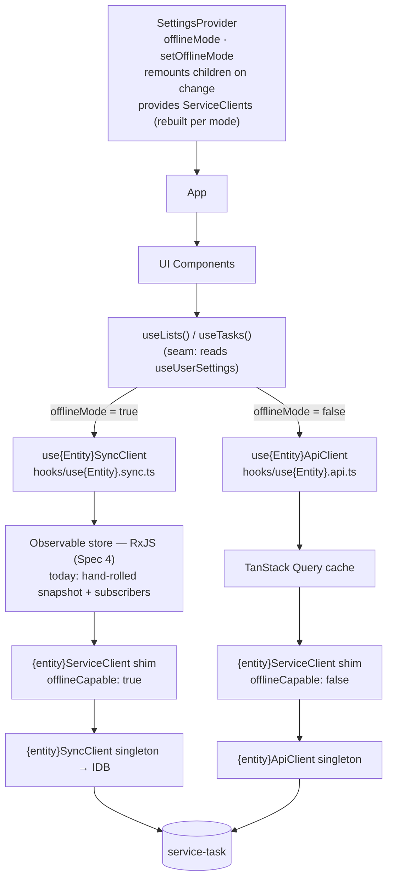

# Design: Online / Offline Modes — two data paths in the PWA

Drafted directly in the gstack initiative-design shape (operator chose a draft over `/office-hours`) on 2026-10-11
Review: lightweight operator review in place of a full `/plan-eng-review` (operator decision, 2026-10-11)
Branch: `feat/144-web-app-api-store`
Repo: [jonpham/PSYKL-System](https://github.com/jonpham/PSYKL-System)
Status: DRAFT — awaiting operator review
Milestone tag: `online-offline-modes`
Sources: [#144](https://github.com/jonpham/PSYKL-System/issues/144) (online-only mode), [#135](https://github.com/jonpham/PSYKL-System/issues/135) (isolate sync behind services), operator direction commit `d537d44`

> **Glossary** (each doc carries its own, per [`AGENTS.md`](../../../AGENTS.md) → Design Doc Discipline):
>
> - PWA = Progressive Web App.
> - IDB = IndexedDB, the browser's local database.
> - Offline Mode = the user setting choosing the data path. `true` (default) = today's IDB + sync queue path. `false` = online-only path.
> - Sync path = Offline Mode `true`: IDB is the read source of truth, writes queue and replay (ADR-M2-005, ADR-TE-003).
> - API path = Offline Mode `false`: the server is the source of truth; the client holds only an in-memory cache.
> - TanStack Query = the `@tanstack/react-query` library — an in-memory server-state cache for React.
> - Seam = the single place a `use{Entity}` hook picks a path.
> - RxJS = Reactive Extensions for JavaScript — an observable-stream library.
> - Shim = a thin, stateless wrapper; here, the `{entity}ServiceClient` that sends each call to the API or Sync inner client.

## Problem Statement

Every entity hook (`useLists`, `useTasks`) reads and writes through IDB and the sync queue. There is no way to see what the **server** says without the local store in between, so a sync bug cannot be told apart from a server bug. Browsers without usable IDB cannot run the app at all.

## Constraints

- Code changes only in `components/web_client/src/` (#144 Scope).
- Sync path behaviour does not change (#144 Not now). It stays the default.
- UI Components keep calling `use{Entity}()` and stay unaware of which path is active.
- Both paths return the **same result type** per entity; neither leaks its framework (no `useSyncExternalStore` or TanStack types in the result).

## Premises

1. The seam belongs in the `use{Entity}` hooks, not in the Service Client — the two paths differ in **state ownership** (module store + IDB vs query cache), not just transport.
2. The mode is fixed for the lifetime of a mounted React tree. Switching remounts the tree.
3. Sync-only surfaces (`SyncView`, `SyncStatus`, `useSyncRecords`, `useSyncDiscrepancy`) are the only UI allowed to know sync exists (#135).

## Architecture



Both paths share one shape: hook → observable cache → Service Client shim → singleton inner client. The shims are stateless and come from `useServiceClients()`. All state (hydration, queue, IDB) lives in the inner singletons, so rebuilding a shim on a mode change costs nothing. IDB opens per call, not when a client is built, so the sync singleton is harmless in a browser without IDB as long as the API path never calls it.

| File (per entity)                     | Owns                                                                                                                                                   |
| ------------------------------------- | ------------------------------------------------------------------------------------------------------------------------------------------------------ |
| `hooks/use{Entity}.ts`                | Result type + the seam. No sync or TanStack imports.                                                                                                   |
| `hooks/use{Entity}.sync.ts`           | Today's implementation: module snapshot store, hydrate, `enqueueWithReplay`, change subscriptions.                                                     |
| `hooks/use{Entity}.api.ts`            | Online implementation over TanStack Query. **Stubbed in Spec 1.**                                                                                      |
| `hooks/useUserSettings.ts`            | Settings context + hook.                                                                                                                               |
| `hooks/useServiceClients.ts`          | Service Client context + hook. Hooks take their Service Client from here, never by module import.                                                      |
| `components/SettingsProvider/`        | Reads/writes the stored mode, keys `children` on it, builds the per-mode Service Client shims.                                                         |
| `services/{entity}-service-client.ts` | Exports the inner singletons (`{entity}ApiClient`, `{entity}SyncClient`) and a `create{Entity}ServiceClient(offlineCapable)` factory — no static shim. |

## Decisions

| #   | Decision                                                                                                                                                                                                                                                                                                                                                                                                                                                                                                                                      | Status                                       |
| --- | --------------------------------------------------------------------------------------------------------------------------------------------------------------------------------------------------------------------------------------------------------------------------------------------------------------------------------------------------------------------------------------------------------------------------------------------------------------------------------------------------------------------------------------------- | -------------------------------------------- |
| 1   | Bifurcate at `use{Entity}()`; each path is a `use{Entity}{Sync\|Api}Client()` hook with the shared result type (#144 Outcome).                                                                                                                                                                                                                                                                                                                                                                                                                | Operator, 2026-10-11                         |
| 2   | TanStack Query backs the **API path**. The sync path keeps `useSyncExternalStore` + IDB. (#144's body has the two labels swapped; its title is right.)                                                                                                                                                                                                                                                                                                                                                                                        | Operator, 2026-10-11                         |
| 3   | Toggling remounts the app tree: `SettingsProvider` renders `children` under `key={mode}`. A conditional hook call in the seam is then safe because the branch never changes within one mount.                                                                                                                                                                                                                                                                                                                                                 | Operator, 2026-10-11                         |
| 4   | #135 (move `sync/` under `services/sync/`) is a later Spec, not part of the seam work.                                                                                                                                                                                                                                                                                                                                                                                                                                                        | Operator, 2026-10-11                         |
| 5   | Offline Mode is stored in **`localStorage`** (`psykl:offline-mode`), not IDB `sync_meta`. The API path's target users may have no IDB. **Re-opens** the device-local-preferences rule in [`docs/DESIGN.md`](../../DESIGN.md) for this one key.                                                                                                                                                                                                                                                                                                | **Proposed — needs operator approval**       |
| 6   | The singletons are the inner clients (`{entity}ApiClient`, `{entity}SyncClient`). `{entity}ServiceClient` is a stateless shim built by `createServiceClient({ apiClient, syncClient, offlineCapable })`, rebuilt when the mode changes, and injected through React context (`useServiceClients()`). `ServiceClientConfig` stops being a discriminated union, since both inner clients always exist. Callers outside React take the shim as an argument. Lands in Spec 1. **Re-opens** ADR-TE-003's constructor-time, static `offlineCapable`. | Operator, 2026-10-11                         |
| 7   | Domain rules shared by both paths (last list cannot be deleted, `canDelete`, ignore unknown ids, `nextListPosition`/`positionBetween`) stay path-independent so the two cannot drift. Exact home decided in the Spec.                                                                                                                                                                                                                                                                                                                         | **Proposed**                                 |
| 8   | Sync-store change notifications (`subscribeToListChanges`, `notifyListSubscribers`, `subscribeToTaskChanges`) live in `use{Entity}.sync.ts`. The seam re-exports them for now so existing consumers stay untouched; Spec 4 re-points those consumers (sync-only surfaces, `page-triggers`, plus `useRecentlyDeleted` via Spec 3) and drops the re-exports.                                                                                                                                                                                    | **Proposed** (re-export form in the sandbox) |
| 9   | The sync path gets an **RxJS observable store** between `use{Entity}SyncClient` and its Service Client shim, formalizing today's hand-rolled snapshot + subscribers + BroadcastChannel. This mirrors TanStack Query on the API path. Operator accepts the cost: two state libraries, push (RxJS) versus pull-and-refetch (TanStack), different mutation models. Neither library's types may appear in `Use{Entity}Result`. Lands with #135 in Spec 4.                                                                                         | Operator, 2026-10-11                         |

## Spec Breakdown (UI-first per production workflow)

| Spec | Slug                      | Delivers                                                                                                                                                                                                                                                                                                                              |
| ---- | ------------------------- | ------------------------------------------------------------------------------------------------------------------------------------------------------------------------------------------------------------------------------------------------------------------------------------------------------------------------------------- |
| 1    | `data-mode-seam`          | `SettingsProvider` + `useUserSettings`, seam in `useLists`/`useTasks`, `.sync.ts` holds today's code, `.api.ts` stubs. Service Client shims injected via `useServiceClients()`. Static singleton shims removed from `useLists.sync`, `useTasks.sync`, `useRecentlyDeleted`, `usePendingTaskIds` (Decision 6). No user-visible change. |
| 2    | `online-only-lists-tasks` | Settings toggle (UI first, against stubs), then TanStack Query implementations of `useListsApiClient`/`useTasksApiClient`. Closes #144.                                                                                                                                                                                               |
| 3    | `online-only-surfaces`    | `useRecentlyDeleted` on both paths; sync-only UI hidden in the API path; page sync triggers idle in the API path.                                                                                                                                                                                                                     |
| 4    | `sync-behind-services`    | Move `sync/` to `services/sync/`; no `hooks/` or `components/` file imports it. Replace the hand-rolled sync store with RxJS (Decision 9). Closes #135.                                                                                                                                                                               |

## Settings surface (Spec 2 — low fidelity)

```
┌ Settings ─────────────────────────────┐
│ Appearance   [System][Light][Dark]    │
│ Contrast     [Standard][Increased]    │
│ Data                                  │
│   Offline Mode            [ ●── On ]  │
│   Keep a copy on this device and      │
│   sync when online.                   │
│ Experiments …                         │
└───────────────────────────────────────┘
Off → app remounts and reads straight from the server.
```

## Open Questions

1. **Pending sync queue on switch to Offline Mode off.** Keep queued writes and replay them on return, warn before switching, or block the switch until the queue drains? (Spec 2.)
2. **Toggle visibility before Spec 2 completes.** Hide the toggle until the API path works, or show it only when experiment tools are on?
3. **Appearance/contrast prefs read IDB at startup** (`preferences/bootstrap.ts`). In a browser with no IDB they fail. Fall back to defaults silently, or move them to `localStorage` too? (Spec 3.)
4. **Default list on the API path.** The sync path bootstraps it on-device (`ensureDefaultList`). The API path presumably expects the server to have it — does the server create it, or does the client create it on first empty fetch?

## Out of Scope

Server or shared-package changes; Apple-native clients; changing sync-path behaviour; multi-tenant auth.
